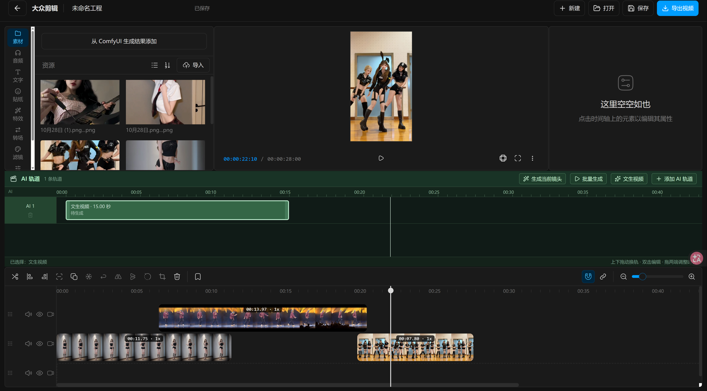
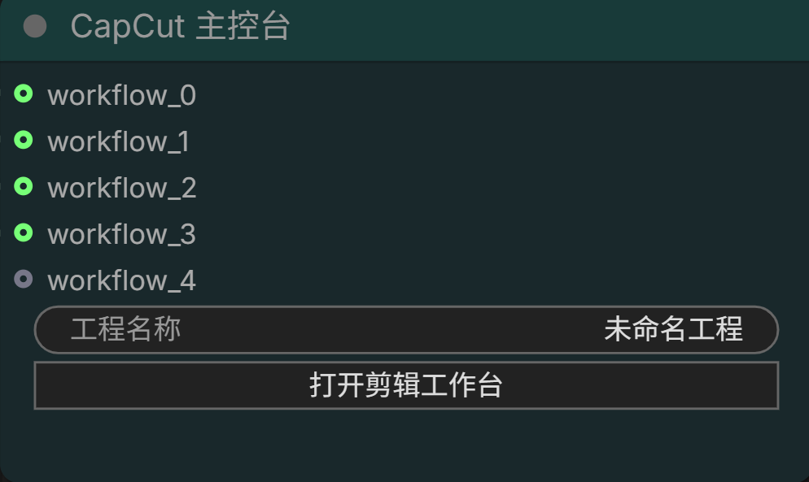
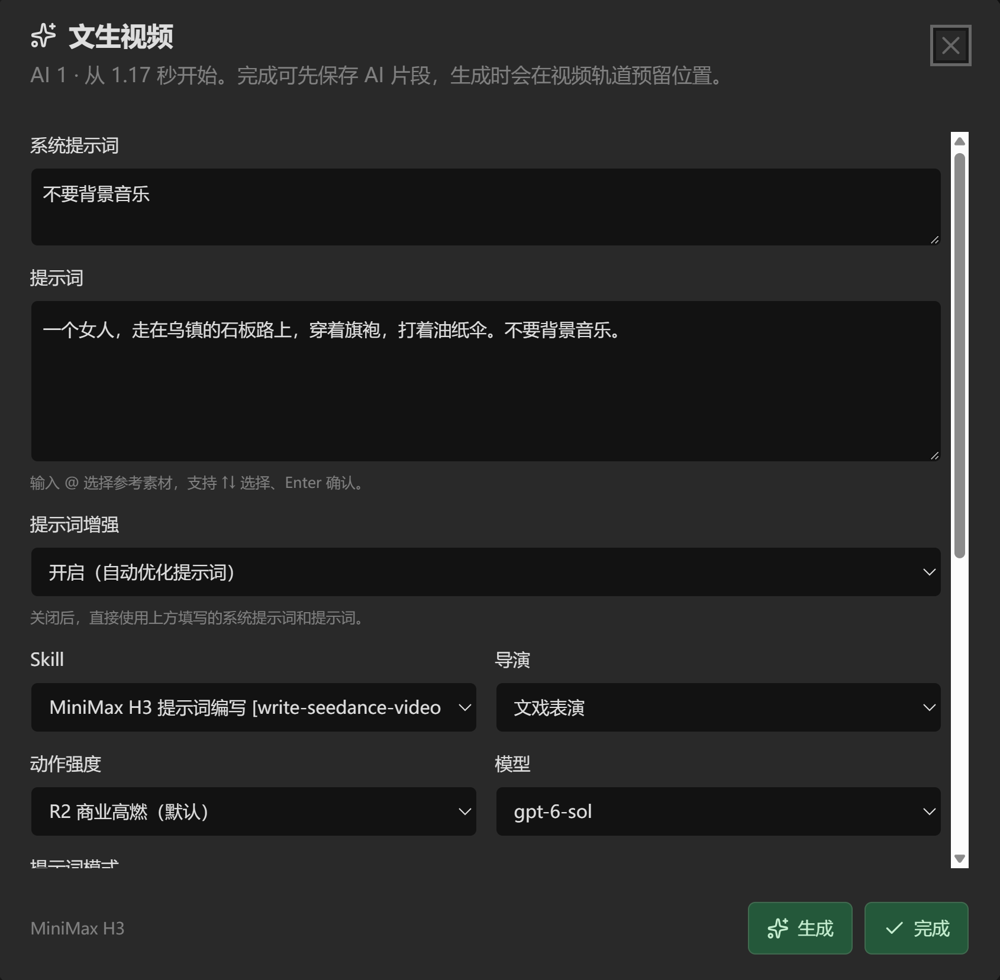

# ComfyUI-CapCut · 主控台预览版

GitHub 发布版：**V0.1.5**。

## 界面预览

### 剪辑工作台



### ComfyUI 主控台



### 文生视频



## 使用许可与集成授权

本项目作者有权独立授权的原创部分采用自定义的 [个人使用与集成授权许可](LICENSE)。个人可以免费下载安装，在自己的 ComfyUI 中正常使用、从源码构建或作仅供本人使用的本地修改；本许可不限制合法创作成果的发布或商业使用。

将上述原创部分整合进其他软件、插件或整合包，再分发软件或修改版，或向他人提供在线软件服务，需要事先取得书面授权。授权申请请联系 **<geleisongde@gmail.com>**。个人在 ComfyUI 中按原有用途安装本插件、连接工作流和运行现有功能，无需另行申请。

**这是带使用范围限制的源码可见许可，不属于标准开源许可。** 前端保留上游 AGPL，第三方代码继续遵守各自许可证，本项目的自定义限制不覆盖它们。因此，不能仅依本协议要求使用这些部分的所有集成都另行取得作者授权。详见 [第三方与既有许可说明](THIRD_PARTY_NOTICES.md)。

## 安装与使用

将本项目放到 `ComfyUI/custom_nodes/ComfyUI-CapCut/`。**正常运行本插件及统一工作流，还需要安装以下三个配套插件：**

- [ComfyUI-MiniMax-prompt](https://github.com/leisongde/ComfyUI-MiniMax-prompt)
- [ComfyUI_ChatGpt_GW](https://github.com/leisongde/ComfyUI_ChatGpt_GW)
- [ComfyUI_Editing_GW](https://github.com/leisongde/ComfyUI_Editing_GW)

请将三个配套插件安装到同一 ComfyUI 环境的 `custom_nodes/` 目录，并分别按照各自 README 完成依赖安装与配置。本项目的 Python 依赖安装命令见下文；各功能所需的其他节点和模型见对应章节。

安装完成后重启 ComfyUI，并刷新浏览器页面。在画布添加 **CapCut → CapCut 主控台**，点击 **打开剪辑工作台**。

统一工作流为 `examples/MiniMax_剪辑版.json`。拖入 ComfyUI 画布即可加载主控台及已连接的生视频、人物替换、人体白模、动作迁移和 Relay VSR 视频放大五个模块；下文各功能均使用这一份工作流。

**大模型服务与 API Key（可选）**：提示词增强、GPT 优化提示词、GPT 看图与编排等辅助功能需要调用大模型 API。使用默认接口时，请前往 [api.lumuyi.online](https://api.lumuyi.online/) 购买 API Key，并在相应功能中填写。

如无需大模型辅助，可关闭提示词增强或 GPT 优化选项；动作迁移留空 API Key 即使用角色模板。关闭这些功能后，仍可进行基本剪辑和运行不依赖大模型 API 的本地工作流，无需购买 Key。

如需接入其他服务，可自行修改对应配套插件源码中的 API 接口地址，并使用该服务的 API Key；接口格式和所选模型需与对应功能兼容。

左侧复用桌面端 Cutia 编辑模块，包含 **素材、音频、文字、贴纸、特效、转场、滤镜、调节、设置**。已打包浏览器编辑器，使用时无需安装 Node.js，也不依赖桌面程序运行。

- 导入本地视频、图片、音频，或最近 30 次 ComfyUI 任务保存的生成结果，支持混剪。
- 多轨时间线、移动、裁切、分割、复制、删除、撤销重做、变速、音量、画面变换和关键帧。
- 时间线的视频、音频和图片片段显示当前时长（分:秒，精确到百分之一秒），裁切和变速拖动时实时更新；视频与音频同时显示倍速，窄片段优先显示时长，悬停可查看完整时间和倍速。
- 连续播放复用解码缓存；打开剪辑台时暂停后台 ComfyUI 画布绘制，返回画布时恢复。
- 剪辑时间线上方提供独立的绿色 AI 多轨区域，可添加、选择、删除空轨道并随工程保存，支持撤销重做；共用时间缩放和播放头。右键 AI 轨道选择“文生视频”，在点击位置生成视频。支持生成当前镜头、批量生成全部镜头，或点击“选择生成”勾选多个镜头后仅生成所选片段。AI 轨道支持分段导出或全部导出，全部导出会按同轨相邻顺序合并片段。
- 复用桌面端的音效/音乐库、文字模板/花字、字体库和贴纸库；支持搜索、下载和本机缓存。
- 内置及在线转场、片段特效、滤镜和调节层，共用预览与导出渲染引擎。
- 工程自动保存、打开和新建工程；可设置分辨率、帧率和背景。
- 智能文本识别时间线中混合后的语音，生成可编辑字幕和对应时间段。
- 浏览器渲染导出 MP4（H.264/AAC）或 WebM，保存到本机并下载成片。建议在本机 Chrome/Edge 中使用，编码支持取决于浏览器和系统。

首次打开旧版工程时转换为新的编辑格式；旧版工程文件和素材继续保留。新工程路径：

- 素材：`ComfyUI/input/CapCut/<用户>/<工程ID>/`。跟随 ComfyUI 自定义 input 目录。
- 工程与素材索引：`ComfyUI/user/<用户>/capcut/studio/`。
- 已下载资源：`ComfyUI/user/<用户>/capcut/resources/`。
- 成片：`ComfyUI/user/<用户>/capcut/exports/`。

在线资源沿用桌面端的 ModelScope 素材库和字体来源，仅下载资源，不上传工程或媒体。下载的素材授权信息沿用原目录。智能抠像复用已随插件打包的 Longpipe 权重；自定义画笔抠像尚未接入。

**运动跟踪**沿用桌面端的 Cutie。选中任意视频片段，在“跟踪 → 选择目标”中直接框选人物或物体；只有一条主视频轨道时也可使用。分析后支持两种用途，可同时开启：

- **素材跟随**：选择时间重叠的上层文字、贴纸、图片或视频，点击“绑定跟随素材”；也可直接“添加跟随文字”。选中上层素材后可调整跟随位置/缩放、锚点和平滑，或点击“使用视频已有轨迹”复用分析结果。
- **主体居中**：让视频画面随目标移动，把主体保持在画面中央；“保持原画面”可恢复。主体居中同步更新绑定素材的位置。如移动后露出画面边缘，可在“画面”中适当放大视频。

轨迹随工程保存并参与预览、导出，绑定和居中操作支持撤销。上层素材也保留直接框选下层视频目标的入口。修改源视频的裁剪或变速后需重新分析目标。

首次点击“开始跟踪”时下载并校验约 **134 MB** 的 `cutie-base-mega.pth`，保存到 `ComfyUI/models/custom-cutout/`；支持断点续传，后续复用。打开面板不会下载模型。推理完全在本机独立进程运行，CUDA 可用且空余显存至少 2 GiB 时使用 CUDA，否则使用 CPU；遵循 ComfyUI 的 `--cpu` 参数。跟踪结束释放进程和推理资源，闲置会话两分钟后自动清理。不需要新增 Python 依赖，Cutie 许可证保留在 `vendor/custom-cutout/`。

自动字幕沿用桌面端的 **OpenMOSS/MOSS-Transcribe-Diarize**。点击“文字 → 智能文本 → 识别轨道字幕”时，首次从 ModelScope 下载约 **1.83 GB** 到 `ComfyUI/models/moss-transcribe-diarize/`（跟随 ComfyUI 的模型根目录）。下载支持断点续传，并校验固定版本文件的 SHA-256；再次使用会复用模型。识别在本机独立 CPU 进程中运行，完成后退出释放内存，不上传音频。CPU 识别需要一定时间；单次输出上限 4096 token，超出时提示分段识别。

Python 依赖列在根目录 `requirements.txt`。便携版在 `ComfyUI_windows_portable` 目录执行：

```powershell
.\python_embeded\python.exe -m pip install -r .\ComfyUI\custom_nodes\ComfyUI-CapCut\requirements.txt
```

编辑器源码在 `frontend/`，执行 `npm install`、`npm run build` 后生成 `editor_dist/`。Cutia、桌面扩展及 Longpipe 的许可证保留在对应源码目录；Longpipe 权重许可证位于 `frontend/public/models/longpipe/LICENSE`。

公开源码时，请保留 `editor_dist/`、`frontend/public/models/`、`frontend/src/renderer/editing/assets/` 和各级 `vendor/` 及其许可证，它们用于直接运行或从源码构建编辑器。`output/`、`.playwright-cli/`、`node_modules/`、Python 缓存和本地环境文件属于开发或运行产物，已加入 `.gitignore`。

源码和示例工作流不预置 API Key；测试中的 Key 字符串为虚构值。运行时保存的 `minimax-key.json`、`motion-transfer-key.json` 位于当前 ComfyUI 用户目录，已按文件名加入忽略规则。发布源码或分享工作流、日志、截图前，请清除自行填写的密钥和个人素材；打包发布时同样需要排除这些本地文件。

## MiniMax H3 固定工作流

统一工作流已连接 **CapCut MiniMax H3 生视频 → CapCut 主控台**。更新插件后需重启 ComfyUI 并刷新页面。

右键绿色 AI 轨道 → **文生视频**：依次填写系统提示词、提示词，选择 Skill、导演、动作强度、模型，再设置时长（4–15 秒）、比例与分辨率（沿用原节点的 MP 单位）。点击“完成”只保存 AI 草稿，无需填写 Key；片段可左右移动、拖两端调整时长，双击或右键重新编辑，时长同步回参数，支持撤销重做。提示词模式固定为 T2VA，所有素材输入均忽略。

右键 AI 轨道空白处 → **图生视频**：上传一张首帧图片，对应原工作流的 71 号图片节点，模式固定为 I2VA。参数、草稿、拖动时长与生成占位沿用文生视频；图片保存在工程素材中，再次打开可预览、更换或移除。此入口不包含尾帧输入。

右键 AI 轨道空白处 → **首尾帧生视频**：分别上传首帧、尾帧图片，对应 71、72 号图片节点，模式固定为 FL2VA。两张图片可先随草稿保存，生成时需要两张都已上传；其余参数、时长调整、进度与生成占位沿用图生视频。

图生视频和首尾帧的图片框均支持点击选择或拖入本地图片，已有图片也可直接拖入替换。

右键 AI 轨道空白处 → **多参考生视频**：依次添加最多 9 张图片、3 段音频和 3 段视频，支持点击或拖拽上传、预览、更换和移除；移除后同类素材编号顺延，对应提示词的 `<Picture 1>`、`<Audio 1>`、`<Video 1>` 等编号。图片按 37、40、43、38、41、44、39、42、45，音频按 63、69、70，视频按 66、67、68 接入原工作流。模式固定为 Ref2VA，生成至少需要一项参考素材；可先保存空草稿，其余参数、时长调整和生成占位沿用前述入口。

填写 API Key 后点击“生成”提交原生队列并返回剪辑页：视频轨道立即预留占位，AI 片段按 ComfyUI 的实际采样步数显示浅色进度条；加载、解码、保存阶段显示对应状态，等待期间不播放进度动画。成功后用生成视频替换占位并加入素材库，失败保留原因以便重试。Key 自动保存到当前 ComfyUI 用户目录的 `capcut/minimax-key.json`，下次打开自动填入，清空输入可删除保存的 Key；不会写入剪辑工程。此入口沿用 73 号节点的提示词处理；下方素材页的通用工作流入口仍可选择直接使用提示词。

在 AI 轨道工具栏开启 **段间引导** 后，同一轨道中首尾相接的后续镜头可以引用上一段成片末尾的画面和音频继续生成。每个可连接镜头都可以切换 **引用上段** 或 **硬切**，并选择引导帧数；只有紧邻的同轨镜头会参与连接。段间引导适用于基础的文生视频和多参考生视频采样，启用 SelfLift、放大与二采、外部音频或其他不兼容模式时会自动按硬切处理。生成过程中会先提取上一段末尾素材，再在采样后裁掉引导帧，最终输出保持设定的镜头时长。

AI 轨道的 **分段导出** 会为每个已完成镜头分别导入成片；**全部导出** 会把同轨、首尾相接的片段按队列顺序合并为一个视频，并同时加入素材库。单组最多合并 128 个片段。素材上传窗口支持从当前工程素材库选择已有图片、视频和音频，并可按名称搜索。

原工作流编号映射（`Minimax生视频 (2).json`）：

| 用途 | 节点编号 |
| --- | --- |
| 多参考图片 1–9 | 37、40、43、38、41、44、39、42、45 |
| 多参考音频 1–3 | 63、69、70 |
| 多参考视频 1–3 | 66、67、68 |
| 图生视频首帧／首尾帧的首帧、尾帧 | 71、72 |
| 系统提示词、用户提示词、合并提示词 | 77、75、76 |
| Key、Skill、导演、动作强度、提示词模型与模式 | 73 |
| 比例与分辨率、时长 | 16、14 |

打开剪辑工作台，在素材页的“AI 工作流”选择“MiniMax H3 生视频”，填写提示词，按需从已导入的工程素材中选择首尾帧、参考图片、视频和音频。多选素材按下方编号对应提示词中的 Picture / Video / Audio；首尾帧的图片编号由原 T8 节点统一处理。

模型、LoRA 和采样设置在画布上的生视频节点配置；工作台设置生成方式、时长、画幅、分辨率和种子。内部沿用所提供工作流的混合模型、Sage Attention 补丁、LoRA、T8 条件与双时钟采样、解码和 VHS 视频保存；默认 15 秒、0.4 MP、16:9、8 步，帧率固定为模型使用的 24 fps。帧数沿用原工作流的 `17n+5` 对齐规则，实际时长可能略长于填写值。参考视频按 24 fps 读取。

点击运行才向 ComfyUI 原生队列提交任务，完成后自动加入素材库，可与导入视频混剪。排队和生成不受普通操作的两分钟等待限制；任务可在 ComfyUI 队列中管理。关闭工作台后，已提交任务继续由 ComfyUI 执行，结果可通过“从 ComfyUI 生成结果添加”导入。

需要原工作流对应的 `minimax-h3-audio-t8`、`ComfyUI_MinimaxH3HybridLoader`、`comfyui-kjnodes`、`comfyui-videohelpersuite` 及其模型。插件不下载模型。素材页通用入口的提示词增强默认关闭；启用时调用配套插件 `ComfyUI-MiniMax-prompt` 的 `MiniMaxH3PromptSkill` 节点，并需填写 API 密钥。示例不携带原文件的密钥或素材；填写的密钥仅保留在当前表单会话，但启用增强后会随任务提交至本机 ComfyUI。视频关闭工作流元数据保存。

## MiniMax H3 人物替换

在统一工作流的工作台素材页选择 **AI 工作流 → MiniMax H3 人物替换** 运行。先导入原视频和替换人物图片，再分别选择；生成结果自动进入素材库，可继续混剪。

视频轨道片段右键 → **AI → 人物替换**：提取当前裁剪、变速和倒放后的片段，自动填入专用窗口的原视频位置。上传替换人物图片，填写目标人物特征、替换提示词、时长与比例。提示词沿用原工作流 2 号节点的英文模板，支持恢复模板；43、9、17、50 号分别接收视频、图片、时长与目标人物描述，44 号比例输入在打包后直接传入 20 号分辨率节点。完成可保存 AI 草稿，生成后从 42 号节点取回视频，替换预留占位。也可从 AI 轨道空白处右键新建人物替换草稿。

开启 **GPT 优化提示词** 后，可设置系统提示词、Skill、导演、动作强度与模型，复用其他生视频组件的本机 Key 和模型列表。生成时通过 `MiniMaxH3PromptSkill` 优化替换指令，再传入 2 号节点；50 号人物定位描述保持原文。Key 不写入工程。关闭优化时直接使用模板，无需 API Key。

“原片中要替换的人”用于 SAM3 定位原人物，“人物替换提示词”描述如何使用 `<Picture 1>` 修改 `<Video 1>`。起始位置从所选素材文件开头计算，不读取时间线片段的裁切或变速；默认处理 5 秒、9:16、0.4 MP，视频按 24 fps 读取，帧数沿用原流程的 `17n+5` 对齐规则。输出按所选比例缩放裁切，实际时长取决于读入帧数及对齐结果。

内部复用原工作流的 SAM3 跟踪、遮罩清理、人物跟踪裁剪、双 LoRA、遮罩 AV 采样与回贴；省去预览、Set/Get 布线和清显存节点。模型和高级跟踪、遮罩、裁剪、羽化参数在画布人物替换节点设置。需要原工作流的 MiniMax H3、SAM3、MaskVidExperiments、KJNodes、VideoHelperSuite 及其模型；模型需提前安装。启用 SelfLift 或放大与二采时，需要对应的 MiniMax H3 Director 节点。GPT 优化需要已安装的 `ComfyUI-MiniMax-prompt`。

声音默认直接使用选定区间的源音轨；“原工作流音轨”沿用 VAE 重建。原视频没有音轨时请选择“静音”，该路径使用空白音频参与 AV 编码，输出不包含音轨。成片关闭工作流元数据保存。

## 人体白模渲染

统一工作流已连接独立的 **CapCut 人体白模渲染**。在素材页 **AI 工作流 → 人体白模渲染** 选择已导入的视频并运行，结果自动加入素材库。

默认输出黑底人体白模，可切换原流程的彩色人物区分或色彩增强版本，每次只执行所选输出需要的节点。内部沿用 RMBG-2.0 绿底抠像、SAM3 跟踪、RT-DETR 人体检测、MoGe 视角估计、SAM3D Body 预测、手部细化、面部表情、姿态平滑与网格渲染；彩色输出继续使用原流程的 SCAIL-2 遮罩合成。

视频轨道片段右键 → **AI → 视频转白模**：自动提取当前裁剪、变速和倒放后的片段，打开只有原视频与提示词的专用窗口。157 号接收片段，154 号提示词在打包后直接传入 15 号文本节点，固定从 256 号取回原流程的彩色人物区分输出，不接 GPT。完成可保存 AI 草稿，生成后自动替换预留占位并加入素材库；也可从 AI 轨道空白处右键新建，双击草稿继续编辑。

工作台设置跟踪人物描述、视频起始位置、时长、帧率、处理长边和声音。默认从文件开头处理全部剩余视频、24 fps、长边 736，保持原比例并对齐到 32 的倍数；不读取时间线片段的裁切或变速。保留原声时视频需有音轨，无音轨视频请选择静音。模型文件、最大人数、跟踪阈值、批量和平滑参数在画布模块节点设置。

需要原工作流对应的 ComfyUI 原生 SAM3、RT-DETR、MoGe、SAM3D Body、SCAIL 节点，以及 ComfyUI-RMBG、ComfyUI_LayerStyle、VideoHelperSuite 和已有模型。本模块不调用 MiniMax 或提示词 API，不携带原文件的素材和预览记录，成片关闭工作流元数据保存。

## 动作迁移

动作迁移模块的“预览模型（Tiny VAE）”下拉框读取 `models/vae_approx`，本机有 `taeh3.safetensors` 时默认选中。内部恢复原 13 号 `ModelPreviewOverrideKJ`，位于动作修复 LoRA 与稀疏注意力之间；关闭稀疏注意力时也使用该预览配置。需要 ComfyUI-KJNodes。

动作迁移模块内部包含原流程 382 号 `easy cleanGpuUsed`：`VAE 解码（36）→ 清理显存（382）→ 视频合成（346）`。需要已安装的 ComfyUI-Easy-Use。

统一工作流已连接 **CapCut MiniMax H3 动作迁移**。在素材页 **AI 工作流 → MiniMax H3 动作迁移** 选择驱动视频与角色图，结果自动加入素材库。人体白模模块生成的结果加入素材库后，也可以作为驱动视频。

视频轨道片段右键 → **AI → 动作迁移**：自动带入当前裁剪、变速和倒放后的片段，打开驱动视频、六张角色图、API Key、分辨率、比例与时长的专用窗口。六个图位分别对应 228、29、244、246、248、250，空位保留角色对应关系；117 接收视频，39 接收尺寸，175 接收时长，314 使用镜头设置中的固定或随机种子，固定从 346 取回成片。提示词自动生成，不显示提示词输入框。API Key 对应原流程 381 号共用密钥，打包后直接传给各角色看图与 376 号自动编排节点；填写后启用这条链路，留空使用角色模板。Key 按用户单独保存在本机，不写入工程，不覆盖其他生视频组件的 Key，AI 轨道单个和批量生成也会读取。自动保留已有音轨，无音轨则输出静音。完成保存草稿，生成后自动替换时间线占位；AI 轨道空白处右键也可新建，双击草稿继续编辑。

角色图按选择顺序对应原流程的蓝、红、绿、品红、青、黄角色位；使用多少张就执行多少个参考分支。保留原流程的 Motion Repair V2（强度 0.35）、Turbo LoRA、8 步采样、Sol-Attn 稀疏注意力和参考图长边 1536 处理。可在模块节点关闭稀疏注意力。

默认使用角色对应模板，可填写补充要求。选择“原流程 GPT 看图描述并编排提示词”时，沿用配套插件 `ComfyUI_ChatGpt_GW` 的看图和编排节点，需要填写该插件使用的 API 密钥；交付文件不带原文件里的密钥、样例素材和预览记录。未开启此项时不调用 GPT API。

默认生成 5 秒、24 fps、竖屏、0.4 百万像素；帧数沿用原公式向上对齐为 `17k+5`，5 秒对应 124 帧，约 5.17 秒。支持视频起点、时长、输出比例、分辨率、驱动处理长边、种子和原声／静音设置；无音轨视频请选择静音。不读取时间线片段的裁切或变速。依赖原生 MiniMax H3、稀疏注意力节点、ComfyUI_LayerStyle、VideoHelperSuite 和原工作流已有模型，不执行停用的 RMBG／MoGe 分支。

## 采样与种子设置

在文生视频、人物替换和动作迁移的镜头设置中，可以选择固定种子或随机种子。使用随机种子时，每次生成会抽取一个 0 到 99,999,999 之间的整数。

统一工作流已将 MiniMax H3 Director 的 SelfLift 和 Refine 节点接到主控台。需要时，可在镜头设置中开启 **SelfLift 渐进采样** 或 **放大与二采**。开启二采后可按百万像素（MP）指定放大分辨率，相关模型和采样参数在画布配置。

## Relay VSR 视频放大

在视频片段上右键选择 **AI → 视频放大**，或在 AI 轨道空白处新建视频放大草稿并选择原视频。可选择 X2 或 X4，细节数值为 0 到 1，默认为 0.8。生成结果会填入时间线并加入素材库。

需要在 ComfyUI 中安装提供 `RelayVSRConditioning` 和 `VSRDecode` 的 Relay VSR 节点，并准备所选倍率对应的扩散模型和 VAE。工作流默认从 `diffusion_models/RelayVSR/` 和 `vae/RelayVSR/` 读取模型。

## 其他工作流接入

主控台提供可选的 `CAPCUT_WORKFLOW` 动态输入，零连接时可独立剪辑。

前端通过 `web/editor.js` 导出的 `registerCapCutWorkflow(nodeType, provider)` 接入模块。只有已连接到该主控台、且注册了适配器的节点会显示运行表单：

```js
registerCapCutWorkflow("YourFixedWorkflowNode", {
    label: "图片生成",
    description: "使用预先配置的工作流生成图片",
    fields: [{ name: "prompt", label: "提示词", type: "textarea", default: "" }],
    async run({ node, values, settings, clip, asset }) {
        // 适配器将固定工作流提交到 ComfyUI 原生队列，等待实际完成。
        // 返回保存结果的文件描述，主控台会将文件导入素材库。
        return { filename: "result.png", subfolder: "", type: "output" };
    },
});
```

上面的代码是接口示例，不是内置模块。`settings` 提供输出宽高和帧率；`clip` / `asset` 提供选中的片段和素材，无选中项时为 `null`。`run` 可返回一个或多个文件描述，失败时抛出错误。模块应传递工作流设置，点击运行后才加载模型和生成；打开工作台不执行队列。

## 请我喝杯咖啡

如果这个插件对你有帮助，欢迎自愿请我喝杯咖啡，支持后续开发与维护。感谢你的支持！


